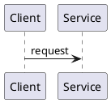

# Smalum

> Русская версия: [README.ru.md](https://github.com/smalum/vscode/raw/main/README.ru.md)

**Diagram-as-code preview** — BPMN, DFD, Struct, Infra, IDEF0 / IDEF1X / IDEF3, PlantUML family, Mermaid, SQL→ER — right in markdown.

## The problem

You write the diagram as text: fast, in git, next to the code. Auto-layout ruins the picture. You fix the layout by hand — then change one source line — and the layout is gone.

A visual editor keeps the layout but kills “diagram as code”: the file stops being the source of truth.

## The solution

Smalum: **text = structure**, **mouse = layout**. Layout is written back into the same file as an `SM:` overlay (coordinates in comments). The next parse takes structure from the code and the picture from the overlay.

This extension is a **read-only preview** of the same parse and the same overlay as the editor. Drop a source fence into `.md` — the diagram renders with your layout. Any supported notation from code, not “one external image”.

Also: `sm` / `smalum` fences in Markdown, `.sm` files and PlantUML (`.puml` / `@startuml`). **Smalum: Preview** — shapes and overlay as on [app.smalum.io](https://app.smalum.io). **Smalum: Copy SVG** / **Smalum: Export SVG…** write a self-contained SVG (plain light-theme colors, opens in any viewer).

## Does / does not

| Does | Does not (on purpose) |
|------|------------------------|
| Parse BPMN, DFD, Struct, Infra, IDEF0 / IDEF1X / IDEF3, PlantUML family, Mermaid, SQL→ER | Edit the canvas with the mouse |
| Render with `SM:` / `%% SM:` overlay | Cloud, sharing, BPMN token simulator |
| Preview in markdown / `.sm` with no network to `*.smalum.io` | Write overlay from the preview |

Full canvas, cloud, and guest editor live on [app.smalum.io](https://app.smalum.io). The extension and the site speak the same language and the same overlay.

## Notations

| Notation | Input |
|----------|-------|
| BPMN | `//smalum/bpmn` |
| DFD | `//smalum/dfd` |
| Struct | `//smalum/struct`, `struct/staff` |
| Infra | `//smalum/infra`, `infra/flow`, `infra/l2`, `infra/l3` |
| IDEF0 / IDEF1X / IDEF3 | `//smalum/idef0`, `idef1x`, `idef3/pfdd`, `idef3/ostn` |
| PlantUML | `@startuml` |
| Mermaid | `flowchart`, `sequenceDiagram`, … + `%% SM:` |
| SQL→ER | `CREATE TABLE` |
| docker-compose → UML deployment | `docker-compose.yml` / `compose.yaml` (`services:` + `image`/`build`) |

## Install

From the VS Code / Cursor Marketplace: **Smalum Preview** (`Smalum.smalum`).  
Cursor / VSCodium: Open VSX `smalum.smalum`.  
Or a `.vsix` from the downloads page on [smalum.io](https://smalum.io).

## Manual QA corpus

[`fixtures/kladovshchik/`](https://github.com/smalum/vscode/raw/main/fixtures/kladovshchik/) — Markdown describing the “Kladovshchik” system with fences for **all** supported notations (PlantUML, Mermaid in `sm`, BPMN/DFD/Infra/Struct, SQL→ER, `SM:` overlay). Open the file → **Markdown Preview** or **Smalum: Preview**.

## Links

- Site: [smalum.io](https://smalum.io)
- Editor: [app.smalum.io](https://app.smalum.io)
- Docs: [docs.smalum.io](https://docs.smalum.io)
- LLM role file: [docs.smalum.io/role.md](https://docs.smalum.io/role.md)

**Small language. Sharp diagrams.**
